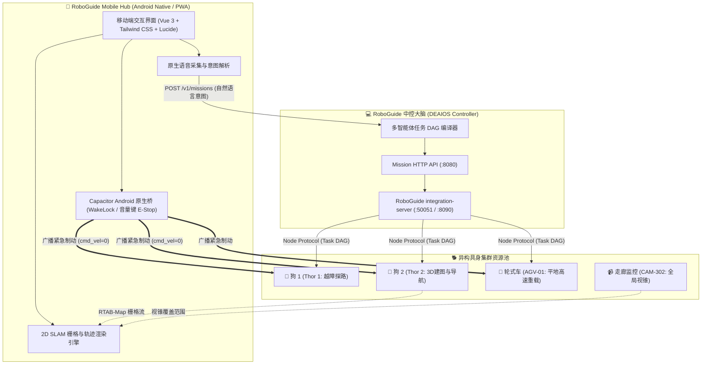

# 📱 RoboGuide Mobile Hub (DEAIOS-Phone)

> **Distributed Embodied AI OS (DEAIOS) — 移动智能体中枢与集群指挥终端**  
> 面向异构具身集群（四足机器狗、轮式巡检车、高位广角监控、机械臂与持机人节点）的 Android / 移动端统一控制与态势感知中枢。

---

## 🌟 核心定位与设计理念

在 **RoboGuide (DEAIOS)** 体系中，手机不仅仅是一个单纯的远程遥控器（Remote Viewer），而是作为集群网络中平等的**第一类实体智能体节点（First-class Node: `phone-node`）**：

1. **人类意图交互代理（Human Intent Agent）**：通过自然语言语音/文字输入，经过大模型（LLM/VLM）编译并动态生成多设备协同 Task DAG；
2. **移动空间锚点（Spatial Anchor）**：在统一坐标系中实时标记持机人（You Are Here）的相对位姿，实现人机协同导览与伴随跟随；
3. **异构集群资源池（Heterogeneous Device Mesh）**：按能力契约（Capability Contracts）动态发现与调度不同设备（越障狗、重载车、监控视锥、机械臂）；
4. **全景空间数字孪生（Unified Spatial Canvas）**：高精 2D/3D RTAB-Map 占据栅格与子图拼板渲染，支持多设备轨迹与航向实时叠加；
5. **硬件级安全急停守卫（Hardware E-Stop Guardian）**：集成物理音量减（Volume Down）按键监听与屏幕防休眠常驻，遇险毫秒级切断动力。

---

## 🏗️ 系统架构图



---

## 🚀 核心功能模块

### 1. 🌐 全景空间画布（Unified Spatial Canvas）
* **高精地图**：渲染 RTAB-Map 0.05m 占用栅格地图，标明房间出入口与关键地标；
* **多机同屏态势**：动态渲染小狗轮廓与车头朝向、AGV 载物槽、监控视锥与持机人点位；
* **触控手势**：支持单指平移、双指捏合缩放（Pinch-to-Zoom）与快捷视口复位。

### 2. 🧩 异构设备资源池（Device Mesh）
* **动态分类筛选**：`🐕 四足狗`、`🚗 轮式车`、`📹 监控`、`📱 手机本机`；
* **卡片式状态**：展示实时电量、坐标位姿 `(X, Y, θ)` 以及注册的原子能力契约（如 `mobility.legged.terrain`、`transport.payload.heavy`）；
* **单机面板**：提供低延迟视频流预览画中画与人工微调虚拟摇杆（Manual Override）。

### 3. 🗣️ 任务指挥中心（Mission Commander）
* **自然语言意图输入**：支持键盘键入与 **“🎙️ 按住说话”语音交互**；
* **一键预设协同流**：
  * `[🗺️ 分布式地图共享接力]`：触发双狗建图、发布至 CAS 仓库、对端导入验证的闭环实验；
  * `[🚶 双机伴随导览]`：狗在人身前 1.5m 领航导引至指定房间；
  * `[📦 异构协同取件]`：高位相机粗筛 ➔ 狗探路 ➔ AGV 搬运货物；
* **动态 Task DAG 进度卡片**：直观展示任务拆解步骤条（`Pending` ➔ `Running` ➔ `Completed`）。

### 4. 🚨 双重急停与安全保障（Safety & E-Stop）
* **界面级急停**：全屏高优先级醒目急停报警，触发触觉震动反馈；
* **Android 原生硬件级急停**：在 `MainActivity.java` 中原生拦截物理 **“音量减（Volume Down）”** 键，长按即刻切断运动输出；
* **防休眠保活**：激活 `FLAG_KEEP_SCREEN_ON`，外场测试期间屏幕永不熄灭，保障 Node 心跳租约不中断。

---

## 🛠️ 技术栈说明

* **前端框架**：Vue 3 (SFC) + Vite + TypeScript
* **样式引擎**：Tailwind CSS + Lucide Icons
* **地图渲染**：HTML5 Canvas 2D 硬件加速视口引擎
* **原生容器**：Capacitor 6 / Android Native (Gradle 8.2.1 + Android SDK 34)

---

## 📦 本地开发与 APK 打包指南

### 1. 环境准备
* Node.js >= 18 (推荐 v20 / v22)
* JDK 21
* Android SDK (API 34, Build-Tools 34.0.0)

### 2. 启动 Web 调试服务
```bash
npm install
npm run dev
# 局域网/手机浏览器直接访问: http://<本机IP>:8088
```

### 3. 同步前端构建至 Android 原生工程
```bash
npm run build
npx cap sync android
```

### 4. 编译输出 Android 原生 APK
* **命令行编译**：
  ```bash
  cd android
  ./gradlew assembleDebug
  # 输出路径: android/app/build/outputs/apk/debug/app-debug.apk
  ```
* **Android Studio 编译**：
  直接使用 Android Studio 打开 `android/` 目录，点击 `Build -> Build APK(s)` 即可。

---

## 📄 授权协议

本项目基于 MIT 协议开源。
